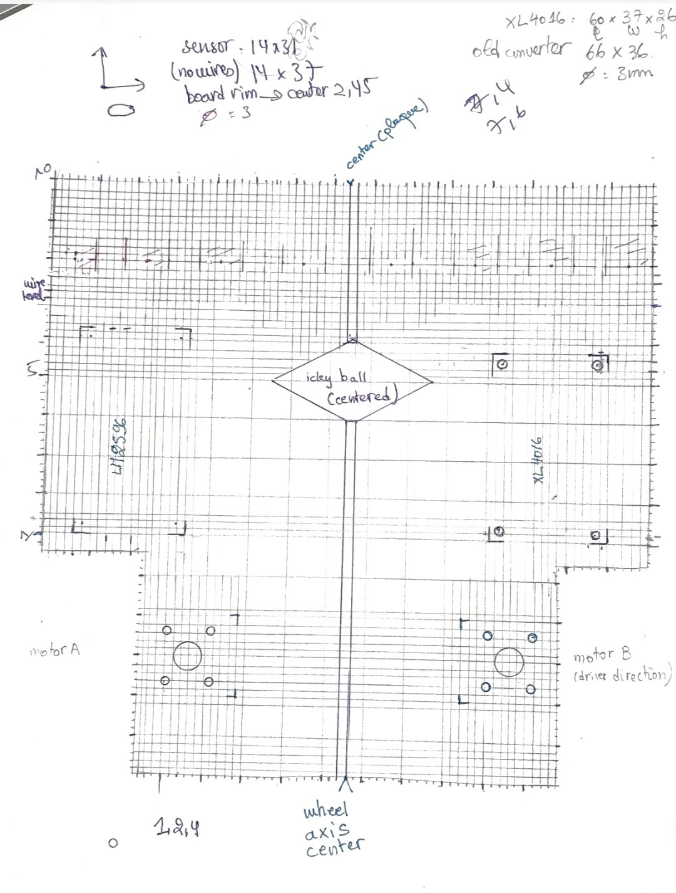
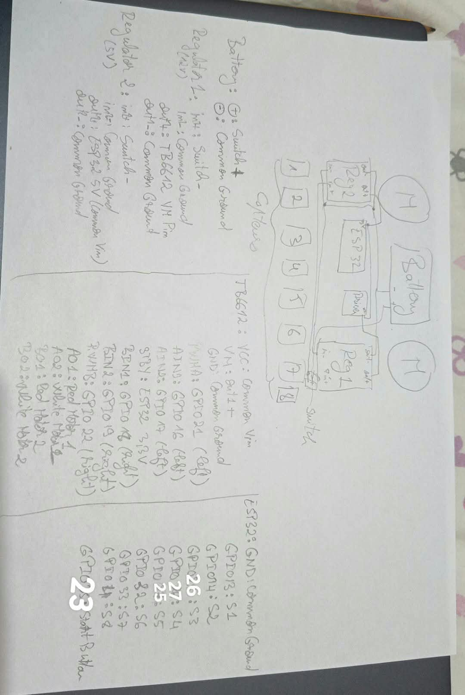
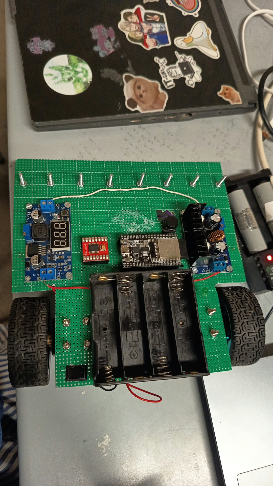
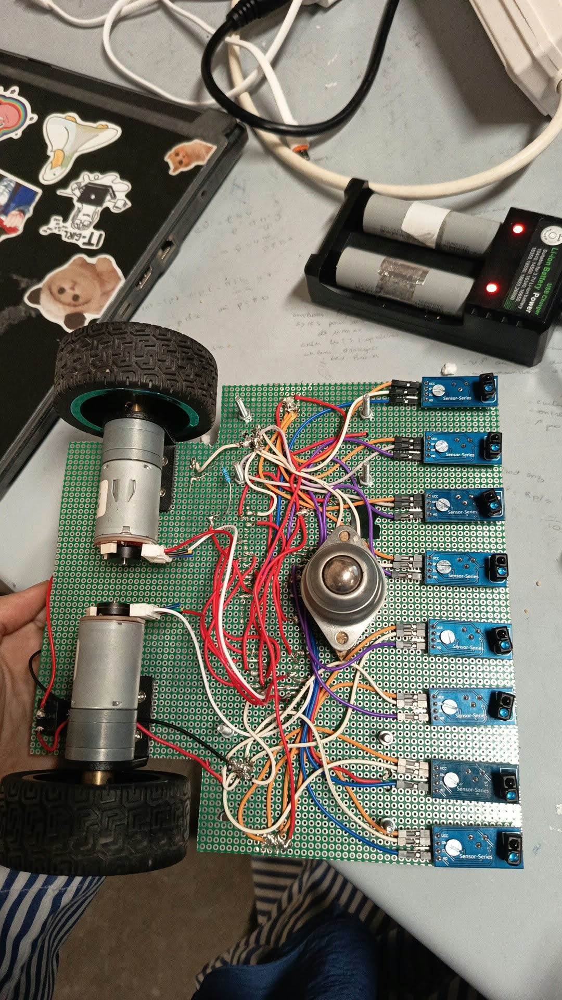

# Dizzy

Autonomous line-following robot built for **RoboCup ENSI 9.0 "ECOVERSE"**, competition *Last Reserve*.

## Overview

The robot must start at the black square and finish at the other black square as fast as possible to win the race.

## Hardware

- **MCU:** ESP32 WROOM-32
- **Motor driver:** TB6612FNG (dual H-bridge)
- **Motors:** 2x DC gear motors (JGA25 type), (encoders not used) 
- **Sensors:** 8x TCRT5000 IR reflectance sensors, mounted in a line
- **Power:** 2-stage regulated supply (motor rail + 5V logic rail), battery pack, master ON/OFF switch
- **Input:** 1x push button (start / calibration control)
  (the sensors and the vcc of the driver are connected to the 3,3V of the ESP32 and there is a green LED connected to pin2 not mentionded in the picture below)

  
  
  
  

## Software

- Written in C++ (platformio in vs code)
- Control loop: PID steering based on a weighted sensor position
- State machine handles: start square, line following, marker detection, finish stop
- Sensor calibration (black/white threshold) runs at startup, triggered by the push button

## Status

In development: PID tuning complete however the robot is still incapable of going beyond the tear shape, but can perfectly complete the map if positionned after the tear obstacle.

## Team members

- Dora Hafsi (leader)
- Isra Abessi
- Yasmine Bouziri
